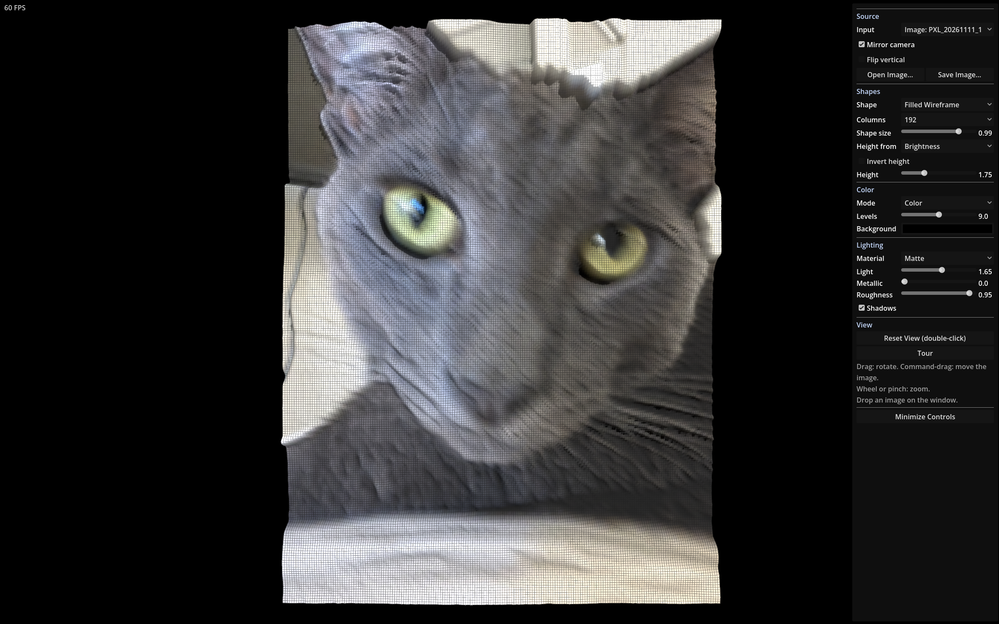
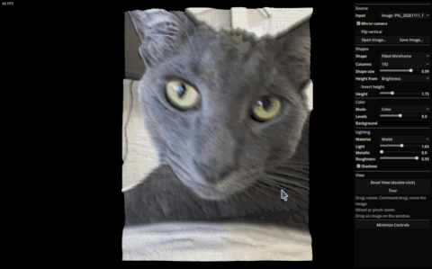
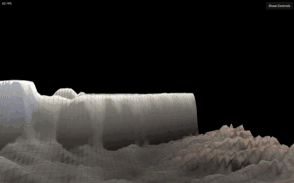

# BumpCamG
Stuart Rankin\
November 2026

## Summary
BumpCamG is a continuation of DeskBlockCam and a much earlier program, BumpCam. Functionality in DeskBlockCam was ported from Swift and Apple APIs to Godot. I realized that what I wanted to do is a perfect fit for Godot (and the one of the APIs (SceneKit) I used in DeskBlockCam will be deprecated soon).

I used Claude to port app to Godot.

The image below shows the starting view of the app with an image of a cat loaded. Filled wireframe was used as the shape. The height of each point was determined by the brightness of the color at that point.

This animation shows the effect of the height applied to regions of the image when rotated.

> **NOTE:** Animations were rendered from .mp4 videos and restricted to 10 frames a second.

### Functionality

Not all of the functionality was initially ported. I wanted to get a proof-of-concept running first. The features ported were:
1. Image analysis and parsing.
2. 3D scene creation and display.
3. Scene attribute settings (lighting, materials, shadows).
4. Most basic shapes.
5. Hue pointer
6. Save as image.
7. Streaming video input.

New features added not in DeskBlockCam:
1. Wireframe shape.
2. Filled wireframe shape.
3. 3D image tours.

Below is a short animation of the tour mode added for BumpCamG.

Not yet ported:
1. Compound shapes.
2. Saving videos.